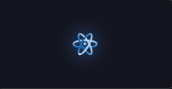

# J.A.R.V.I.S. — Personal AI Assistant

A personal desktop assistant built on the Claude API. It remembers things between sessions, can read and change files and run shell commands (asking for confirmation before anything risky), talks back with natural-sounding voice, and lives as a small always-on-top widget in the corner of the screen.

<p align="center"></p>
<p align="center"><em>The desktop widget, idle. Click it to open the chat panel.</em></p>

## Features

- **Persistent memory:** preferences and notes are stored in a local SQLite database and loaded into context on every request. Jarvis saves and forgets memories through `remember` / `forget` tags in its replies, and you can add one directly with `remember: <note>`.
- **Tool calling with confirmation gating:** Jarvis can read, write, and delete files, list directories, and run shell commands. Destructive actions (deletes, overwrites, risky shell commands) are detected and need an explicit yes before they run.
- **Desktop widget:** a frameless, draggable, always-on-top `pywebview` window that sits idle as an animated icon and expands into a chat panel on click. Its position persists between launches, and it can auto-start with Windows.
- **Voice:** speech-to-text and text-to-speech through ElevenLabs, wake-phrase detection, and barge-in, so you can interrupt Jarvis mid-sentence.
- **Context-aware replies:** time-of-day greetings, a session conversation history, and error handling around API calls.

## Tech stack

Python 3.11+ · Anthropic Claude API (tool use) · SQLite · pywebview (HTML/CSS/JS UI) · ElevenLabs (TTS/STT) · sounddevice / NumPy · openWakeWord

## Getting started

```bash
python3 -m venv .venv && source .venv/bin/activate   # Windows: .venv\Scripts\activate
pip install -r requirements.txt
cp .env.example .env    # then add your ANTHROPIC_API_KEY and ELEVENLABS_API_KEY
```

Run it:

```bash
python src/main.py         # command-line assistant
python src/widget_app.py   # desktop widget (Windows)
```

`run_widget.vbs` launches the widget with no console window and can go in the Windows Startup folder. Edit its paths to match your machine first.

## Project structure

```
src/
  assistant.py    # Claude calls, tool-use loop, confirmation flow, memory tags
  memory.py       # SQLite memory: remember / forget / recall
  tools.py        # file + shell tools, risk detection
  tts.py          # ElevenLabs text-to-speech and speech-to-text
  widget_app.py   # pywebview desktop widget and audio loop
  main.py         # CLI entry point
memory/           # local memory data (gitignored)
docs/ROADMAP.md   # what's next
```

## Status

Phase 1 is done: the CLI assistant, memory, tool calling, the desktop widget, and voice are all working. Next up is account integrations (calendar, email, GitHub) and scheduled check-ins. See [docs/ROADMAP.md](docs/ROADMAP.md).
